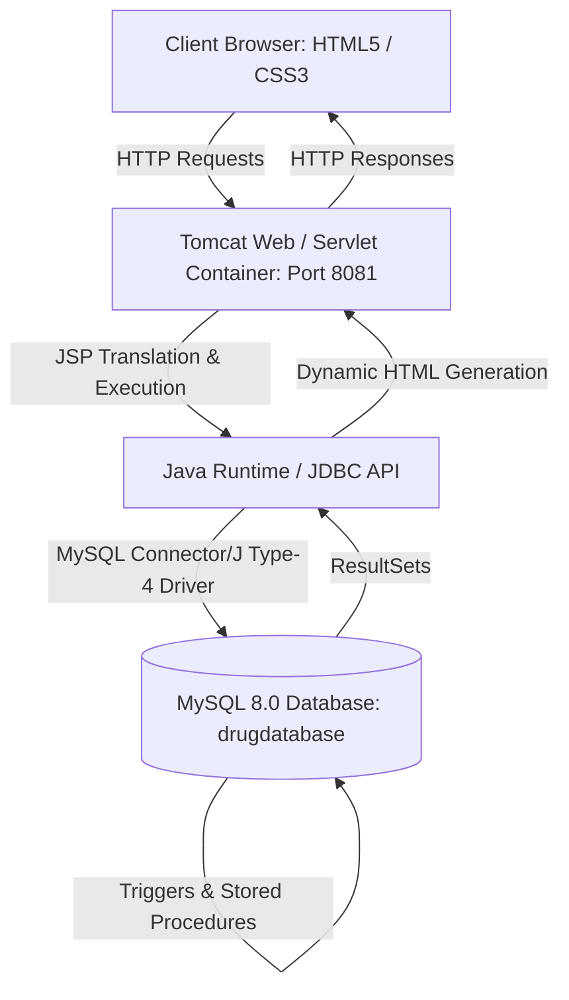
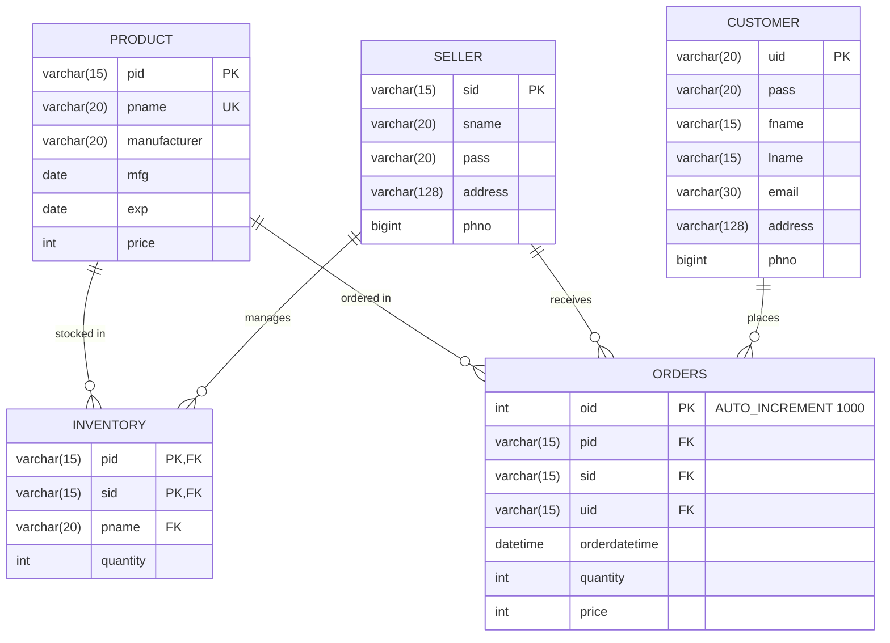

# Pharmacy Drug Management System - Complete Guide & Viva Preparation

---

## Part 1: Project Overview & Working Mechanism

### 1. What is this Project?
The **Pharmacy Drug Management System** is a **3-Tier Web-based Management Application** designed to automate and streamline interactions between **Medicine Sellers (Vendors)** and **Customers (Buyers)**.

- **For Customers**: Enables searching medicines, checking stock availability in real time, placing drug orders, and tracking order history.
- **For Sellers/Pharmacies**: Enables managing the medicine catalog, updating prices, restocking inventory, editing/deleting products, and tracking customer orders.
- **Automated Database Triggers**: Ensures business integrity—automatically timestamps orders and dynamically decrements inventory upon every successful purchase.



---

### 2. System Architecture (3-Tier Architecture)

1. **Presentation Layer (Tier 1 - Client)**:
   - Built using **HTML5**, **CSS3**, and **JSP tags**.
   - Renders forms for login, registration, catalog display, inventory management, and order receipts.
   - User inputs are submitted via HTTP `POST` or `GET` to the web container.

2. **Application / Business Logic Layer (Tier 2 - Web Server)**:
   - Hosted on **Apache Tomcat 10.1** (port 8081).
   - Java Server Pages (JSPs) are compiled into Java Servlets by Tomcat's **Jasper engine**.
   - Handles session tracking via `HttpSession` and `JSESSIONID` cookies.
   - Executes business rules (e.g., verifying stock availability, role-based redirection).

3. **Data Layer (Tier 3 - Database)**:
   - **MySQL 8.0 RDBMS** running on `localhost:3306`.
   - Stores structured relational data across 5 normalized tables.
   - Enforces referential integrity using **Foreign Keys** with `ON DELETE CASCADE`.
   - Executes database **Triggers** and **Stored Procedures**.

---

### 3. Database Schema & Relationships



#### Key Schema Highlights:
1. **Primary Keys**:
   - `customer(uid)`: Unique identifier for each customer.
   - `seller(sid)`: Unique identifier for each seller/vendor.
   - `product(pid)`: Unique medicine identifier.
   - `orders(oid)`: Auto-incrementing order ID (starts at 1000).
   - `inventory(pid, sid)`: **Composite Primary Key** ensuring a specific seller can have only one inventory record per product.

2. **Foreign Keys with `ON DELETE CASCADE`**:
   - If a product is removed, its inventory entries and past order references are automatically cleaned up to maintain integrity without orphan records.

3. **Triggers**:
   - **`updatetime`** (`BEFORE INSERT ON orders`):
     ```sql
     SET NEW.orderdatetime = NOW();
     ```
     Automatically records the exact system timestamp when an order is created.
   - **`inventorytrigger`** (`AFTER INSERT ON orders`):
     ```sql
     UPDATE inventory
     SET quantity = quantity - qnty
     WHERE pid = productid;
     ```
     Automatically deducts the ordered medicine quantity from the seller's inventory in real time.

4. **Stored Procedures**:
   - **`getorders(IN param1 VARCHAR(20))`**: Selects all orders placed by customer `param1`.
   - **`getsellerorders(IN param1 VARCHAR(20))`**: Selects all orders received by seller `param1`.

---

### 4. End-to-End Application Workflow

#### Workflow A: Customer Journey
1. **Registration / Login**:
   - User accesses `Index.html` $\rightarrow$ `Login.html` or `Register.html`.
   - Role selection: `utype = 1` denotes Customer.
   - On successful login, the user's `uid` is saved into HTTP Session:
     `session.setAttribute("currentuser", uid1)`.
   - Redirects to `Homepage.jsp`.
2. **Browsing Medicines (`Buy.jsp`)**:
   - Queries `product` joined with `inventory` to fetch medicines, manufacturers, expiry dates, stock, and prices.
   - If `quantity > 0`, renders a quantity input and "Buy" button.
   - If `quantity == 0`, disables purchase and displays "Out Of Stock".
3. **Placing an Order (`PlaceOrder.jsp`)**:
   - Calculates total price = `orderquantity * unit_price`.
   - Executes `INSERT INTO orders(...)`.
   - Database triggers execute:
     - `updatetime` attaches current timestamp.
     - `inventorytrigger` reduces stock from `inventory`.
4. **Viewing Orders (`Orders.jsp`)**:
   - Calls stored procedure `getorders(uid)` via `CallableStatement`.
   - Renders tabular order receipt history with Order ID, Product ID, Price, Quantity, and Order DateTime.

#### Workflow B: Seller Journey
1. **Seller Login**:
   - Role selection: `utype = 2` denotes Seller.
   - Saved into session and redirected to `SellerHomepage.jsp`.
2. **Product Catalog Management (`AddProduct.html` / `AddProduct.jsp`)**:
   - Allows adding new medicines (name, manufacturer, dates, price) into the `product` table.
3. **Restocking (`AddInventory.jsp` / `UpdateInventory.jsp`)**:
   - Adds or updates inventory quantities tied to the seller's `sid`.
4. **Modifying / Deleting Medicines (`EditProductTables.jsp`, `EditProduct.jsp`, `DeleteProduct.jsp`)**:
   - Allows updating medicine pricing and details or deleting discontinued products.
5. **Monitoring Store Orders (`SellerOrders.jsp`)**:
   - Calls stored procedure `getsellerorders(sid)` to view orders placed for products owned by this seller.

---

## Part 2: Comprehensive Viva Questions and Answers

### Section A: Core Java & Web Technologies (JSP, Servlet, Tomcat)

#### Q1: What is JSP? How does it differ from a Servlet?
**Answer**:
- **JSP (JavaServer Pages)** is a server-side technology used to create dynamic, data-driven web pages. It combines HTML tags with Java code (scriptlets, expressions, directives).
- **Difference**:
  - Servlets are pure Java classes where HTML is embedded inside `out.println()` statements (business-logic centric).
  - JSPs are HTML documents with Java embedded inside `<% %>` tags (presentation-centric).
  - Internally, Tomcat **translates every JSP into a Java Servlet** before compiling it into bytecode (`.class`).

#### Q2: What is the lifecycle of a JSP page in Apache Tomcat?
**Answer**:
A JSP page goes through 7 phases:
1. **Translation**: Jasper parser converts `page.jsp` into a Java servlet file (`page_jsp.java`).
2. **Compilation**: `javac` compiles the `.java` file into `.class` bytecode.
3. **Loading**: Classloader loads the servlet class into JVM memory.
4. **Instantiation**: Container creates an instance of the servlet.
5. **Initialization (`jspInit()`)**: Called once to initialize resources.
6. **Request Handling (`_jspService()`)**: Called for each incoming HTTP request to process `request` and `response`.
7. **Destruction (`jspDestroy()`)**: Called when the application is undeployed or server stops.

#### Q3: What is the role of Apache Tomcat in this project?
**Answer**:
Apache Tomcat is both an **HTTP Web Server** and a **Servlet/JSP Container**.
- As an HTTP server, it listens for incoming TCP requests on port 8081 and returns static assets (HTML, CSS, images).
- As a Servlet container, it implements the Jakarta/Java EE Servlet and JSP specifications, manages the servlet lifecycle, executes server-side Java code, and maintains session states.

#### Q4: What are JSP Implicit Objects? Which ones are used in this project?
**Answer**:
JSP implicit objects are predefined Java objects provided by the container that can be used directly inside scriptlets without explicit declaration.
This project uses:
- **`request`** (`HttpServletRequest`): To extract form data via `request.getParameter("fieldName")`.
- **`response`** (`HttpServletResponse`): To perform client-side redirects using `response.sendRedirect("page.jsp")`.
- **`session`** (`HttpSession`): To persist logged-in user state (`session.setAttribute()`, `session.getAttribute()`).
- **`out`** (`JspWriter`): To output dynamic HTML or JavaScript alerts to the client browser (`out.println()`).

#### Q5: How does Session Management work in this application?
**Answer**:
- When a user logs in, `session.setAttribute("currentuser", uid)` binds the user ID to the user's active session.
- Tomcat creates a unique session token called **`JSESSIONID`** and transmits it to the client browser in an HTTP response header (`Set-Cookie: JSESSIONID=...`).
- On every subsequent request, the browser sends back this cookie. Tomcat resolves the session memory and makes the user ID available via `session.getAttribute("currentuser")`.
- When the user clicks **Logout** (`Logout.jsp`), `session.invalidate()` destroys the session on the server.

#### Q6: What is the difference between `response.sendRedirect()` and `RequestDispatcher.forward()`?
**Answer**:
- **`response.sendRedirect()` (used here)**: Client-side redirect. The server sends an HTTP 302 status code with a `Location` header to the browser. The browser initiates a completely new HTTP `GET` request. The URL in the browser address bar changes.
- **`RequestDispatcher.forward()`**: Server-side forward. The server transfers execution to another resource internally without notifying the browser. Faster and preserves the original `request` attributes, but URL does not change.

---

### Section B: Database, SQL, Triggers & Stored Procedures

#### Q7: What is JDBC? Which type of JDBC driver does this project use?
**Answer**:
- **JDBC (Java Database Connectivity)** is a Java standard API (`java.sql`, `javax.sql`) that defines how Java applications connect, query, and manipulate relational databases.
- This project uses a **Type-4 Pure Java Driver** (`com.mysql.cj.jdbc.Driver` / MySQL Connector/J). It converts JDBC calls directly into MySQL network protocol packets over TCP/IP without needing any native client libraries installed on the host.

#### Q8: What is the difference between `Statement`, `PreparedStatement`, and `CallableStatement`?
**Answer**:
1. **`Statement`**: Used for executing static SQL queries without parameters. Compiled by database every time it executes.
2. **`PreparedStatement` (heavily used in this project)**:
   - Used for parameterized queries with placeholders (`?`).
   - The database precompiles the SQL template once.
   - Values are bound using setters (`ps.setString(1, val)`), which **prevents SQL Injection** and improves execution performance.
3. **`CallableStatement` (used in `Orders.jsp` and `SellerOrders.jsp`)**:
   - Specifically used to invoke **Stored Procedures** in the database:
     `conn.prepareCall("call getorders(?)")`.

#### Q9: What is a Database Trigger? Explain the triggers in this project.
**Answer**:
A **Trigger** is a stored procedural code block in the database that automatically executes (fires) in response to a specific database event (`INSERT`, `UPDATE`, or `DELETE`) on a particular table.

In our project:
1. **`updatetime` Trigger**:
   - **Timing**: `BEFORE INSERT ON orders FOR EACH ROW`
   - **Purpose**: Automatically injects system date and time (`SET NEW.orderdatetime = NOW()`) into the new row before it is written to disk.
2. **`inventorytrigger` Trigger**:
   - **Timing**: `AFTER INSERT ON orders FOR EACH ROW`
   - **Purpose**: Retrieves the newly ordered product ID and quantity, and immediately updates `inventory`:
     ```sql
     UPDATE inventory SET quantity = quantity - qnty WHERE pid = productid;
     ```
     This prevents data inconsistency where an order is recorded but inventory stock remains unchanged.

#### Q10: What is a Stored Procedure? Why did you use stored procedures for retrieving orders?
**Answer**:
A **Stored Procedure** is a precompiled collection of SQL statements stored directly on the database server.
We used:
- `getorders(param1)` for customer order history.
- `getsellerorders(param1)` for vendor order tracking.

**Advantages**:
1. **Precompiled Execution**: Faster execution because query optimization and parsing happen once.
2. **Reduced Network Traffic**: The client sends only the procedure name and parameter rather than entire multi-line SQL strings.
3. **Security & Abstraction**: Application code doesn't need direct knowledge of underlying table structures.

#### Q11: What is a Composite Primary Key? Where is it used in this project?
**Answer**:
A **Composite Primary Key** is a primary key composed of two or more columns that together uniquely identify a record in a table.
- In table **`inventory`**, the composite key is **`(pid, sid)`**.
- **Reason**: Multiple sellers can sell the same product (`pid`), and a seller (`sid`) can sell multiple products. The combination of `(pid, sid)` uniquely identifies the inventory stock row for that specific seller-product pair.

#### Q12: What does `ON DELETE CASCADE` do in this database schema?
**Answer**:
`ON DELETE CASCADE` is a foreign key referential action. When a record in the parent table (`product`, `customer`, or `seller`) is deleted, all corresponding child rows in referencing tables (`inventory`, `orders`) that reference that parent key are **automatically deleted** by the RDBMS engine.
- This prevents **Orphan Records** (e.g., inventory rows pointing to a medicine ID that no longer exists in `product`).

#### Q13: What are ACID properties, and how do they apply to this project?
**Answer**:
- **Atomicity**: Either all operations of an order (inserting order, decrementing stock, setting timestamp) complete, or none do.
- **Consistency**: Database transitions from one valid state to another. Constraints (foreign keys, quantities) are preserved.
- **Isolation**: Concurrent orders by multiple customers do not interfere with each other's stock calculations.
- **Durability**: Once an order is committed, the changes survive system restarts or crashes.

---

### Section C: Architecture, Security & Best Practices

#### Q14: How does this project prevent SQL Injection?
**Answer**:
By utilizing **`PreparedStatement`** with parameterized queries (`?` placeholders).
- Instead of string concatenation (e.g. `"SELECT * FROM user WHERE uid='" + input + "'"`), parameters are sent separately from the SQL command structure.
- The MySQL driver and database treat user input strictly as literal data values, escaping special characters (quotes, semicolons), making it impossible for malicious SQL code to alter the query logic.

#### Q15: Why is business logic placed in JSP pages in this mini-project, and how would it be improved in an enterprise architecture?
**Answer**:
- **In this mini-project (Model 1 Architecture)**: Logic is placed directly in JSP scriptlets for simplicity, ease of demonstration, and self-contained execution without complex build pipelines.
- **Enterprise Improvement (Model 2 / MVC Architecture)**:
  - **Model**: Java Beans / POJOs representing business entities (`Customer`, `Product`).
  - **View**: Clean JSPs using JSTL (JSP Standard Tag Library) and EL (Expression Language) with **zero Java scriptlets**.
  - **Controller**: Dedicated Java Servlets or Spring Boot REST Controllers handling routing and business validation.
  - **DAO Layer**: Data Access Object layer with connection pooling (e.g. HikariCP) separating SQL from controller logic.

#### Q16: Why should database connections always be closed in a `finally` block?
**Answer**:
Database connections, statements, and result sets consume native operating system sockets and database server memory.
- If an exception occurs and resources are not closed, it causes a **connection leak**. Eventually, MySQL runs out of available connection slots (`Too many connections` error).
- Enclosing `.close()` calls inside a **`finally` block** guarantees that resources are closed regardless of whether the try-block succeeds or throws an exception.

#### Q17: What is the purpose of `web.xml`?
**Answer**:
`web.xml` is the **Deployment Descriptor** of a Java EE web application. It informs the servlet container about:
- Application configuration parameters.
- Session timeout duration (e.g. 30 minutes in our project).
- Welcome file list (`<welcome-file>Index.html</welcome-file>`) which sets the default entry point when browsing to the root URL.
- Servlet and filter mappings (when servlets are configured via XML).

---

### Section D: Quick Reference Cheat-Sheet for Examiners

| Topic | Key Term to Say in Viva |
| :--- | :--- |
| **Architecture** | "3-Tier Client-Server Architecture (Presentation, Business Logic, Relational Database)" |
| **Server Engine** | "Apache Tomcat 10.1 serving as Servlet Container and HTTP Web Server on port 8081" |
| **JSP Execution** | "Jasper translates JSP to Servlet source code, `javac` compiles to bytecode, executed via `_jspService()`" |
| **Driver Type** | "Type-4 Pure Java JDBC Driver (`mysql-connector-j-8.4.0.jar`)" |
| **Query Security** | "`PreparedStatement` with bind variables prevents SQL Injection" |
| **Stock Automation** | "`inventorytrigger` (`AFTER INSERT ON orders`) automatically deducts inventory" |
| **Timestamping** | "`updatetime` trigger (`BEFORE INSERT ON orders`) sets `orderdatetime = NOW()`" |
| **Order Fetching** | "Stored procedures `getorders` and `getsellerorders` called via `CallableStatement`" |
| **Referential Integrity** | "Foreign key constraints with `ON DELETE CASCADE` prevent orphan records" |
| **Session Tracking** | "`HttpSession` tracked via client `JSESSIONID` cookie" |
