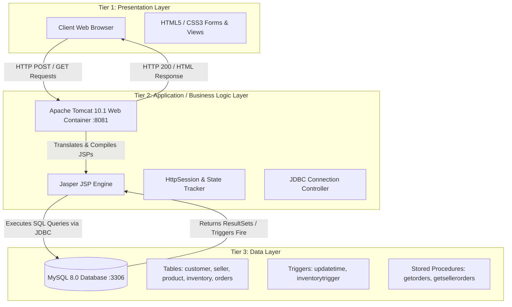
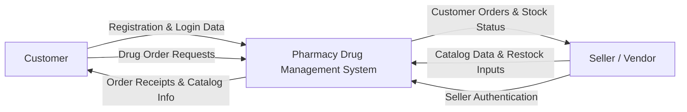
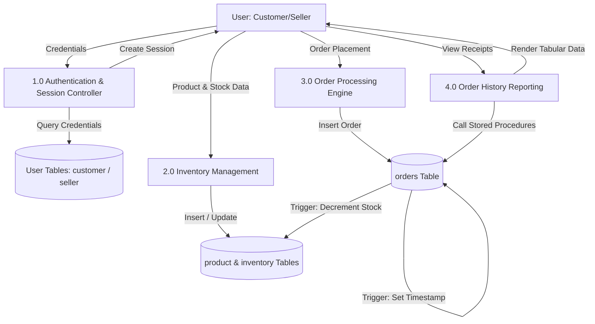
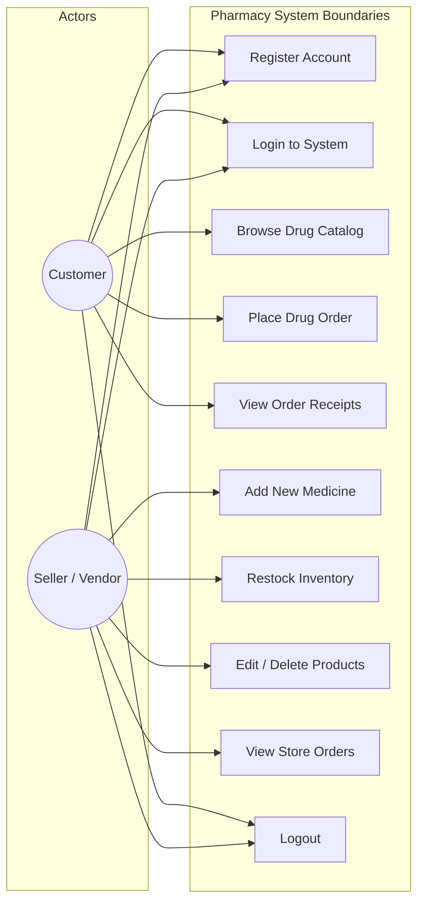
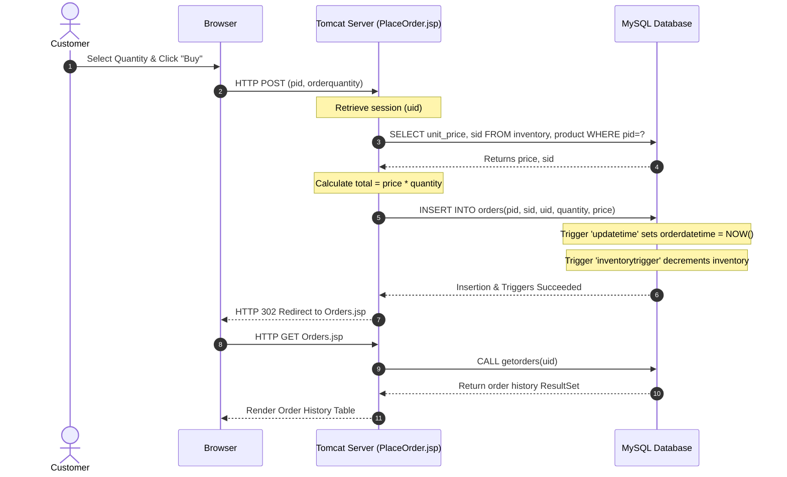
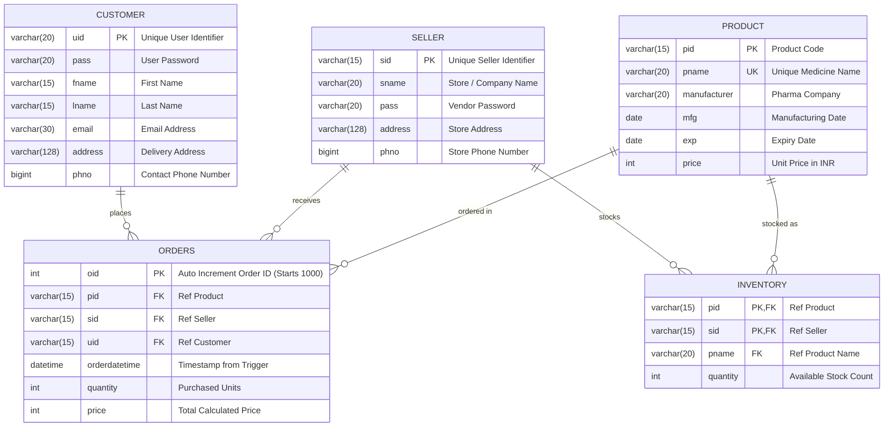

# PHARMACY DRUG MANAGEMENT SYSTEM
## A Mini-Project Report Submitted in Partial Fulfillment of the Requirements for the Degree of Bachelor of Technology / Computer Applications / Computer Science & Engineering

---

## BONAFIDE CERTIFICATE (Sample Template)

This is to certify that the project report entitled **"PHARMACY DRUG MANAGEMENT SYSTEM"** is a bonafide work carried out by **[Student Name]** (Roll No: **[Student Roll Number]**) under my supervision and guidance, in partial fulfillment of the requirements for the award of the Degree of **Bachelor of Technology / BCA / MCA in Computer Science & Engineering**.

<br>

**Project Guide / Supervisor**  
Name: ______________________  
Designation: ________________  
Department of Computer Science & Engineering  

<br>

**Head of Department (HOD)**  
Name: ______________________  
Department of Computer Science & Engineering  

**External Examiner Signature:** ______________________  
**Date:** ______________________  

---

## ACKNOWLEDGEMENT

I express my deepest gratitude to my project guide, **[Guide Name]**, for their continuous guidance, support, and constructive criticism throughout the development of this project.

I also extend my sincere thanks to the Head of Department, **[HOD Name]**, and all faculty members of the Department of Computer Science & Engineering for providing the technical environment and facilities needed to complete this project.

Finally, I would like to thank my family and friends for their moral support and encouragement during this endeavor.

**[Student Name]**  
Roll No: [Roll Number]  

---

## TABLE OF CONTENTS

1. **Abstract**
2. **Chapter 1: Introduction**
   - 1.1 Project Overview
   - 1.2 Motivation
   - 1.3 Objectives
   - 1.4 Scope of the Project
3. **Chapter 2: System Analysis**
   - 2.1 Existing System & Limitations
   - 2.2 Proposed System & Advantages
   - 2.3 Feasibility Study (Technical, Operational, Economic)
4. **Chapter 3: System Requirement Specifications (SRS)**
   - 3.1 Hardware Requirements
   - 3.2 Software Requirements
   - 3.3 Functional Requirements
   - 3.4 Non-Functional Requirements
5. **Chapter 4: System Design & Architecture**
   - 4.1 3-Tier Architecture Model
   - 4.2 Data Flow Diagrams (DFD Level 0, Level 1)
   - 4.3 UML Diagrams (Use Case, Sequence, Activity)
   - 4.4 Entity-Relationship (ER) Diagram
6. **Chapter 5: Database Design & Data Dictionary**
   - 5.1 Table Schemas & Constraints
   - 5.2 Database Triggers
   - 5.3 Stored Procedures
7. **Chapter 6: Module Description & Implementation**
   - 6.1 Authentication & Session Management
   - 6.2 Customer Module
   - 6.3 Seller Module
8. **Chapter 7: Software Testing & Test Cases**
   - 7.1 Testing Methodology
   - 7.2 Detailed Test Case Table
9. **Chapter 8: Results & Screen Layouts**
10. **Chapter 9: Conclusion & Future Scope**
11. **References & Bibliography**

---

## ABSTRACT

In modern healthcare distribution, manual and isolated pharmacy management systems lead to inaccuracies in drug stock tracking, human error during bill computation, and inconvenience for patients searching for available medications. 

The **Pharmacy Drug Management System** is a full-featured 3-tier web application developed to bridge the gap between licensed pharmaceutical vendors (**Sellers**) and buyers (**Customers**). Developed using **JavaServer Pages (JSP)**, **Apache Tomcat Web Container**, and **MySQL Relational Database**, the system provides a dual-portal interface:
1. **Customer Portal**: Allows users to register, search medicine catalogs, view real-time stock levels and prices, place orders, and review past order receipts.
2. **Seller Portal**: Empowers pharmacies to manage medicine catalogs, update pricing, restock quantities, and monitor store-specific incoming purchase orders.

The system incorporates server-side session management (`HttpSession` / `JSESSIONID`) and utilizes advanced database routines—including **Database Triggers** (for automated order timestamping and real-time inventory decrementing) and **Stored Procedures** (for high-performance order retrieval)—ensuring ACID compliance, data consistency, and elimination of race conditions.

---

## CHAPTER 1: INTRODUCTION

### 1.1 Project Overview
The Pharmacy Drug Management System is designed to automate day-to-day operations in pharmaceutical retail and distribution. It replaces paper ledger records and disjointed spreadsheets with a centralized, web-accessible database application accessible from standard modern web browsers.

### 1.2 Motivation
During urgent medical requirements, patients frequently visit multiple physical retail stores only to find medicines out of stock. Simultaneously, pharmacy store owners face challenges tracking inventory levels, monitoring batches, and processing orders manually. This project was motivated by the need for a transparent, synchronized, and automated solution connecting both parties in real time.

### 1.3 Objectives
- To design a clean, role-based dual-access portal (Customer and Seller).
- To maintain an accurate, real-time medicine inventory.
- To automate inventory deductions upon purchase using database triggers to prevent over-selling.
- To provide persistent transaction histories for buyers and sellers using precompiled stored procedures.
- To ensure responsive, secure interaction with SQL injection defense via parameterized `PreparedStatement`.

### 1.4 Scope of the Project
The application addresses the end-to-end purchasing and stocking workflow:
- **In-Scope**: User authentication, catalog display, stock checks, order placement, automated inventory decrement, order history reporting, product modification, and deletion.
- **Out-of-Scope (Future Work)**: External digital payment gateway (UPI/Cards), prescription optical character recognition (OCR), and courier shipping tracking.

---

## CHAPTER 2: SYSTEM ANALYSIS

### 2.1 Existing System & Limitations
In conventional manual or standalone desktop pharmacy systems:
- **Stock Discrepancy**: Sales are recorded post-purchase or at day-end, causing delays in stock adjustment.
- **Zero Remote Visibility**: Customers must physically travel to stores to check medicine availability.
- **Error-Prone Pricing**: Price updates require manually updating price stickers or separate registry entries.
- **High Data Redundancy**: Information about manufacturers, batch dates, and buyers is stored repetitively.

### 2.2 Proposed System & Advantages
The proposed web application addresses all aforementioned issues:
- **Real-Time Inventory Synchronization**: Integrated database triggers decrement physical stock instantly upon purchase.
- **Centralized Accessibility**: Deployed on an HTTP servlet container accessible across any networked computer or mobile device.
- **Relational Integrity**: 3rd Normal Form (3NF) database schema eliminates redundant customer and product records.
- **Instant Receipts**: Automatic calculation of unit prices multiplied by quantities with immediate receipt generation.

### 2.3 Feasibility Study
- **Technical Feasibility**: Built with mature, open-source enterprise standards (Java EE, Apache Tomcat 10, MySQL 8). Readily runnable on any computer supporting a JVM.
- **Operational Feasibility**: Intuitive browser GUI with clean navigation requiring zero specialized training for end-users or vendors.
- **Economic Feasibility**: Developed entirely using open-source, zero-licensing cost software stack (Java JDK, Apache Tomcat, MySQL Community Server, HTML5/CSS3).

---

## CHAPTER 3: SYSTEM REQUIREMENT SPECIFICATIONS (SRS)

### 3.1 Hardware Requirements
- **Processor**: Intel Core i3 / AMD Ryzen 3 or higher.
- **RAM**: Minimum 4 GB (8 GB recommended for simultaneous IDE, Tomcat, and MySQL services).
- **Hard Disk Space**: Minimum 500 MB free disk space for runtime logs and database files.
- **Network Interface**: Ethernet or Wi-Fi network interface adapter (TCP/IP stack).

### 3.2 Software Requirements
- **Operating System**: Microsoft Windows 10/11, Linux (Ubuntu/Debian), or macOS.
- **Java Development Kit (JDK)**: Java SE 17 or Java SE 21+ (Compatible up to JDK 26).
- **Web / Servlet Container**: Apache Tomcat 9.x / 10.x (Configured on port 8081).
- **Database Management System**: MySQL Community Server 8.0+.
- **Database Driver**: MySQL Connector/J (Type-4 pure Java JDBC Driver, `mysql-connector-j-8.4.0.jar`).
- **Web Browser**: Google Chrome, Mozilla Firefox, Microsoft Edge, or Safari.

### 3.3 Functional Requirements
1. **User Management**:
   - Customer and Seller registration with unique ID validation.
   - Secure login mechanism with role-based routing (`utype = 1` for Customer, `utype = 2` for Seller).
   - Session termination via explicit Logout.
2. **Catalog & Inventory Management (Seller)**:
   - Add new products with PID, Name, Manufacturer, Mfg Date, Exp Date, and Price.
   - Restock existing inventory quantity for a specific pharmacy.
   - Edit pricing and product attributes or delete discontinued items.
3. **Ordering & Sales (Customer)**:
   - Browse medicine cards showing live stock, manufacturer, and unit price.
   - Input purchase quantity bounded by available stock.
   - Automatic execution of database triggers on checkout.
4. **Reporting**:
   - Customer Order History via stored procedure `getorders(uid)`.
   - Seller Order Ledger via stored procedure `getsellerorders(sid)`.

### 3.4 Non-Functional Requirements
- **Security**: Parameterized queries using `PreparedStatement` to defend against SQL Injection.
- **Performance**: Precompiled stored procedures for sub-millisecond retrieval of transaction records.
- **Data Integrity**: Enforced through primary keys, unique keys, and foreign keys with `ON DELETE CASCADE`.
- **Availability & Portability**: Standardized WAR deployment model portable to any compliant servlet container.

---

## CHAPTER 4: SYSTEM DESIGN & ARCHITECTURE

### 4.1 3-Tier Architecture Model



---

### 4.2 Data Flow Diagrams (DFD)

#### DFD Level 0 (Context Level Diagram)


#### DFD Level 1 Diagram


---

### 4.3 UML Diagrams

#### Use Case Diagram


#### Sequence Diagram (Order Placement Workflow)


---

### 4.4 Entity-Relationship (ER) Diagram



---

## CHAPTER 5: DATABASE DESIGN & DATA DICTIONARY

### 5.1 Data Dictionary

#### 1. Table: `customer`
Stores profiles of registered buyers.
| Column Name | Data Type | Constraint | Description |
| :--- | :--- | :--- | :--- |
| **`uid`** | `VARCHAR(20)` | **PRIMARY KEY**, NOT NULL | Unique customer login ID |
| `pass` | `VARCHAR(20)` | DEFAULT NULL | Customer account password |
| `fname` | `VARCHAR(15)` | DEFAULT NULL | First name |
| `lname` | `VARCHAR(15)` | DEFAULT NULL | Last name |
| `email` | `VARCHAR(30)` | DEFAULT NULL | Contact email address |
| `address` | `VARCHAR(128)`| DEFAULT NULL | Shipping delivery address |
| `phno` | `BIGINT` | DEFAULT NULL | 10-digit mobile phone number |

#### 2. Table: `seller`
Stores profiles of verified vendor pharmacies.
| Column Name | Data Type | Constraint | Description |
| :--- | :--- | :--- | :--- |
| **`sid`** | `VARCHAR(15)` | **PRIMARY KEY**, NOT NULL | Unique seller identifier |
| `sname` | `VARCHAR(20)` | DEFAULT NULL | Business / store name |
| `pass` | `VARCHAR(20)` | DEFAULT NULL | Seller portal password |
| `address` | `VARCHAR(128)`| DEFAULT NULL | Physical pharmacy location |
| `phno` | `BIGINT` | DEFAULT NULL | Store contact phone number |

#### 3. Table: `product`
Stores master medicine definitions.
| Column Name | Data Type | Constraint | Description |
| :--- | :--- | :--- | :--- |
| **`pid`** | `VARCHAR(15)` | **PRIMARY KEY**, NOT NULL | Medicine stock keeping unit (SKU) |
| `pname` | `VARCHAR(20)` | **UNIQUE**, DEFAULT NULL | Commercial medicine name |
| `manufacturer`| `VARCHAR(20)` | DEFAULT NULL | Pharmaceutical manufacturing firm |
| `mfg` | `DATE` | DEFAULT NULL | Date of production |
| `exp` | `DATE` | DEFAULT NULL | Expiration date |
| `price` | `INT` | DEFAULT NULL | Unit price per strip/item |

#### 4. Table: `inventory`
Associates physical stock quantities with a particular seller.
| Column Name | Data Type | Constraint | Description |
| :--- | :--- | :--- | :--- |
| **`pid`** | `VARCHAR(15)` | **COMPOSITE PK**, FK $\rightarrow$ `product(pid)` | Product identifier |
| **`sid`** | `VARCHAR(15)` | **COMPOSITE PK**, FK $\rightarrow$ `seller(sid)` | Selling pharmacy identifier |
| `pname` | `VARCHAR(20)` | FK $\rightarrow$ `product(pname)` | Redundant display cache name |
| `quantity` | `INT UNSIGNED`| DEFAULT NULL | Number of units available |

#### 5. Table: `orders`
Stores completed financial purchases and transaction metadata.
| Column Name | Data Type | Constraint | Description |
| :--- | :--- | :--- | :--- |
| **`oid`** | `INT` | **PRIMARY KEY**, `AUTO_INCREMENT=1000` | Unique bill / receipt number |
| `pid` | `VARCHAR(15)` | FK $\rightarrow$ `product(pid)` ON DELETE CASCADE | Ordered medicine |
| `sid` | `VARCHAR(15)` | FK $\rightarrow$ `seller(sid)` ON DELETE CASCADE | Fulfilling seller |
| `uid` | `VARCHAR(15)` | FK $\rightarrow$ `customer(uid)` ON DELETE CASCADE| Buying customer |
| `orderdatetime`| `DATETIME` | DEFAULT NULL | Populated automatically by trigger |
| `quantity` | `INT UNSIGNED`| DEFAULT NULL | Number of units bought |
| `price` | `INT UNSIGNED`| DEFAULT NULL | Total transaction cost (`qty * unit_price`) |

---

### 5.2 Database Triggers

#### Trigger 1: `updatetime`
- **Event**: `BEFORE INSERT ON orders FOR EACH ROW`
- **Purpose**: Automatically injects system timestamp into the row before persisting to disk.
```sql
DELIMITER //
CREATE TRIGGER updatetime BEFORE INSERT ON orders FOR EACH ROW
BEGIN
    SET NEW.orderdatetime = NOW();
END//
DELIMITER ;
```

#### Trigger 2: `inventorytrigger`
- **Event**: `AFTER INSERT ON orders FOR EACH ROW`
- **Purpose**: Guarantees synchronized real-time stock deduction without relying on application code.
```sql
DELIMITER //
CREATE TRIGGER inventorytrigger AFTER INSERT ON orders FOR EACH ROW
BEGIN
    DECLARE qnty INT;
    DECLARE productid VARCHAR(20);

    SELECT pid INTO productid FROM orders ORDER BY oid DESC LIMIT 1;
    SELECT quantity INTO qnty FROM orders ORDER BY oid DESC LIMIT 1;

    UPDATE inventory
    SET quantity = quantity - qnty
    WHERE pid = productid;
END//
DELIMITER ;
```

---

### 5.3 Stored Procedures

#### Procedure 1: `getorders`
- **Purpose**: Fetches historical receipts for a specific customer.
```sql
DELIMITER //
CREATE PROCEDURE getorders(IN param1 VARCHAR(20))
BEGIN
    SELECT * FROM orders WHERE uid = param1;
END //
DELIMITER ;
```

#### Procedure 2: `getsellerorders`
- **Purpose**: Fetches customer orders assigned to a specific seller store.
```sql
DELIMITER //
CREATE PROCEDURE getsellerorders(IN param1 VARCHAR(20))
BEGIN
    SELECT * FROM orders WHERE sid = param1;
END //
DELIMITER ;
```

---

## CHAPTER 6: MODULE DESCRIPTION & IMPLEMENTATION

### 6.1 Authentication & Session Management Module
- **Files**: `Index.html`, `Login.html`, `Login.jsp`, `Logout.jsp`, `Register.jsp`, `SellerRegister.jsp`.
- **Functionality**:
  - Validates user credentials against respective SQL tables using `PreparedStatement`.
  - On valid login, initializes session state:
    ```java
    HttpSession httpSession = request.getSession();
    httpSession.setAttribute("currentuser", uid1);
    ```
  - Directs customer to `Homepage.jsp` and seller to `SellerHomepage.jsp`.
  - Invalidate session on `Logout.jsp` via `session.invalidate()`.

### 6.2 Customer Ordering Module
- **Files**: `Homepage.jsp`, `Buy.jsp`, `PlaceOrder.jsp`, `Orders.jsp`.
- **Functionality**:
  - Displays medicines in responsive cards.
  - Dynamically evaluates stock:
    ```jsp
    <% if (rs.getInt("quantity") > 0) { %>
      <input type="number" name="orderquantity" max="<%=rs.getInt("quantity")%>" required>
      <button>Buy</button>
    <% } else { %>
      <button disabled>Out Of Stock</button>
    <% } %>
    ```
  - Calculates total price securely on server:
    ```java
    ps2.setInt(5, qr * unitPrice);
    ps2.executeUpdate();
    ```

### 6.3 Seller Catalog & Inventory Module
- **Files**: `SellerHomepage.jsp`, `AddProduct.html`, `AddProduct.jsp`, `AddInventory.jsp`, `UpdateInventory.jsp`, `EditProductTables.jsp`, `DeleteProduct.jsp`.
- **Functionality**:
  - Allows pharmacy owners to add new drug formulations.
  - Increases quantity on restock via:
    ```sql
    UPDATE inventory SET quantity = quantity + ? WHERE sid = ? AND pid = ?
    ```
  - Executes cascading deletes via `DeleteProduct.jsp`.

---

## CHAPTER 7: SOFTWARE TESTING & TEST CASES

### 7.1 Testing Methodology
1. **Unit Testing**: Verified individual JSP scriptlet database connectivity and parameter parsing.
2. **Integration Testing**: Validated the complete workflow from customer checkout $\rightarrow$ trigger execution $\rightarrow$ inventory decrement verification.
3. **Boundary Value Testing**: Tested zero-stock edge cases and input field boundaries.

### 7.2 Detailed Test Cases Table

| Test ID | Module Tested | Test Scenario Description | Test Input Data | Expected Result | Actual Result | Status |
| :--- | :--- | :--- | :--- | :--- | :--- | :--- |
| **TC-01** | Login | Customer login with valid credentials | `uid: kashyap_user`, `pass: user123`, `utype: 1` | Redirect to `Homepage.jsp`, session established | Redirected to `Homepage.jsp` | **PASS** |
| **TC-02** | Login | Login with invalid password | `uid: kashyap_user`, `pass: wrongpass`, `utype: 1` | Redirect to `LoginError1.html` | Redirected to `LoginError1.html` | **PASS** |
| **TC-03** | Login | Login with non-existent User ID | `uid: ghostuser`, `pass: any`, `utype: 1` | Redirect to `LoginError2.html` | Redirected to `LoginError2.html` | **PASS** |
| **TC-04** | Registration | Register with duplicate User ID | `uid: kashyap_user` | Block registration, redirect to `RegisterError1.html` | Redirected to `RegisterError1.html` | **PASS** |
| **TC-05** | Registration | Register with mismatched passwords | `pass1: pass123`, `pass2: mismatch` | Block registration, redirect to `RegisterError2.html` | Redirected to `RegisterError2.html` | **PASS** |
| **TC-06** | Catalog | Out-of-stock medicine display | Product with `quantity = 0` | Input box hidden, button displays "Out Of Stock" | Button displays "Out Of Stock" | **PASS** |
| **TC-07** | Ordering | Purchase valid medicine quantity | Buy 5 units of `P101` (stock: 150) | Order inserted into `orders`, stock decremented to 145 | Order created (#1000), stock shows 145 | **PASS** |
| **TC-08** | Triggers | Order datetime auto-population | Place order without datetime | Trigger `updatetime` automatically sets current timestamp | `orderdatetime` populated with current time | **PASS** |
| **TC-09** | Restock | Seller restocks inventory quantity | Restock +50 units to `P101` | Inventory record updated to `quantity = quantity + 50` | Stock updated correctly | **PASS** |
| **TC-10** | Cascade | Delete product from catalog | Delete product `P108` | Product removed; inventory and past orders cleaned via cascade | Cascade deletion succeeded | **PASS** |

---

## CHAPTER 8: RESULTS & SCREEN LAYOUTS

The application was deployed on **Apache Tomcat 10.1** on port **8081** connected to **MySQL 8.0**. The following screens demonstrate the operational state:

1. **Home / Landing Page (`Index.png`)**:
   - Clean entry portal providing routing for Login, Customer Registration, and Vendor Registration.
2. **Login Screen (`Login.png`)**:
   - Role dropdown (Customer vs. Seller) with User ID and Password fields.
3. **Customer Homepage (`CustomerHomepage.png`)**:
   - Displays authenticated customer profile card, delivery address, phone, and navigation menu (Home, Buy, Orders).
4. **Medicine Catalog (`Buy 1.png` & `Buy 2.png`)**:
   - Responsive multi-column grid displaying medicine cards with drug name, ID, manufacturer, expiry date, live stock, unit price, and purchase controls.
5. **Vendor Homepage (`VendorHomepage.png`)**:
   - Seller dashboard with navigation for Catalog Addition, Editing, Restocking, and Order tracking.
6. **Restock Screen (`Restock.png`)**:
   - Seller catalog overview with real-time numeric inputs enabling immediate inventory replenishment.
7. **Vendor Registration Screen (`SellerRegister.png`)**:
   - Onboarding form capturing pharmacy store name, vendor ID, address, contact phone, and credentials.

*(Note: The actual high-resolution image files corresponding to these views are archived in the `Screenshots/` directory of the project repository).*

---

## CHAPTER 9: CONCLUSION & FUTURE SCOPE

### 9.1 Conclusion
The **Pharmacy Drug Management System** successfully accomplishes all stated objectives:
- It eliminates the overhead and errors of paper-based pharmacy ledgers.
- It provides a centralized, transparent platform for customers to inspect medicine availability remotely.
- It enforces strict relational data integrity and real-time inventory synchronization using database triggers.
- It proves that a standard 3-tier architecture with JavaServer Pages and MySQL provides a stable, performant, and cost-effective solution for local pharmaceutical commerce.

### 9.2 Future Scope & Enhancements
1. **Prescription Upload & Verification**: Implement a module allowing customers to upload digital doctor prescriptions (PDF/JPG) with seller approval before drug dispensing.
2. **Integrated Payment Gateway**: Integration of payment APIs (e.g. Razorpay, Stripe) for UPI, credit card, and net-banking transactions.
3. **Automated Expiry Warning Alerts**: Scheduled cron jobs alerting sellers of batches expiring within 30 to 60 days.
4. **Enhanced Security**: Implementation of industry-standard password hashing algorithms (BCrypt / Argon2) and migration to Spring Boot MVC architecture.

---

## REFERENCES & BIBLIOGRAPHY

1. **Cay S. Horstmann**, *Core Java Volume I – Fundamentals*, 12th Edition, Prentice Hall.
2. **Bryan Basham, Kathy Sierra, Bert Bates**, *Head First Servlets and JSP*, 2nd Edition, O'Reilly Media.
3. **Paul DuBois**, *MySQL Developer's Library*, 5th Edition, Addison-Wesley.
4. **Apache Tomcat Documentation**: Official Apache Tomcat 10 Architecture Guide ([https://tomcat.apache.org](https://tomcat.apache.org)).
5. **Oracle Java Documentation**: Java Database Connectivity (JDBC) API Specification ([https://docs.oracle.com/en/java](https://docs.oracle.com/en/java)).
6. **W3Schools & MDN Web Docs**: HTML5 & CSS3 Web Standards Reference.
